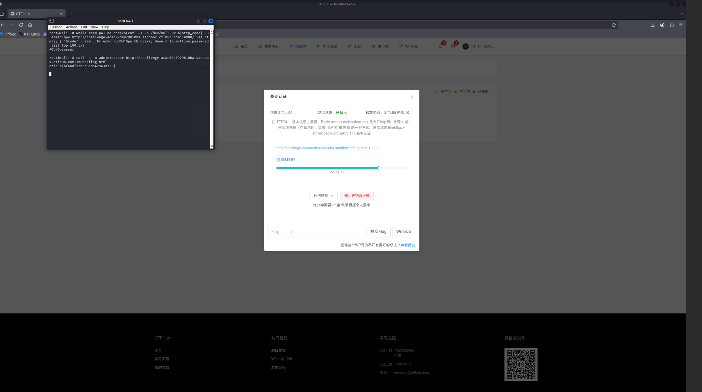

# WP：基础认证

> **CTFHub 路径**：技能树 → Web → Web 前置技能 → HTTP 协议 → 基础认证
> **任务**：按题目提示完成 HTTP Basic 认证，拿到 flag。
> **提示**：观察 `401 Unauthorized` 响应和 `WWW-Authenticate: Basic` 响应头。Basic 认证把 `用户名:密码` 做 Base64 编码后放在 `Authorization` 请求头里，Base64 不是加密。
> **截图要求**：能看到 `Authorization: Basic ...` 请求头，以及认证成功后的 flag 或页面。

---

## 题目信息

| 项目 | 内容 |
| --- | --- |
| 环境地址 | （填写） |
| Flag | （填写） |

## 解题过程

（写清楚：你第一次访问时看到什么？401 响应和 WWW-Authenticate 告诉了你什么？你是怎么完成认证的？至少 3—5 句话。）

## 关键请求/响应

```http
（必须粘贴 Authorization: Basic ... 请求头，以及认证成功后的响应）
```

## 原理与复盘

Basic 认证把“用户名:密码”先拼成 `用户名:密码` 这样的字符串，再做 Base64 编码，然后放进请求头 `Authorization: Basic <base64>` 里发出去。Base64 只是编码不是加密，任何人拿到就能一条命令解回明文，所以它必须跑在 HTTPS 上，否则等于明文传输。第一次不带凭据访问时，服务器会返回 401，并用响应头 `WWW-Authenticate: Basic realm="..."` 告诉浏览器“这里要登录”，浏览器才弹出那个熟悉的小框。

---

## 截图



> 可以在这份 WP 中另加过程截图；检查时只看指定图片，额外图片不检查。

